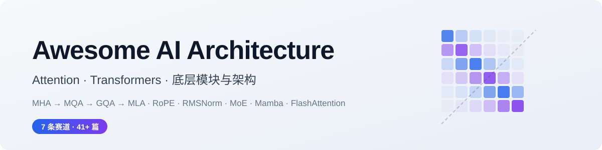

# Awesome AI Architecture [](https://awesome.re)

<picture>
  <source media="(prefers-color-scheme: dark)" srcset="assets/banner-dark.svg">
  
</picture>

**聚焦「AI 模型的底层模块与架构」的开源清单。**

以注意力机制（Attention）与 Transformer 为主线，覆盖从 2014 年注意力机制起源（Bahdanau 对齐、
记忆网络）到 2017 年 Transformer、再到今天前沿模型（DeepSeek-V3、Kimi Linear、Qwen3-Next 等）
内部真正起作用的每一个底层模块：
注意力变体、高效注意力、位置编码、归一化、FFN 与 MoE、状态空间与混合架构、模块可解释性，
外加一条横切的**实现与教学**赛道。支持由 GitHub Actions 从 arXiv 自动抓取、打分、去重、归类，
持续更新论文清单。

| 收录论文 | 近 7 天新论文 | 赛道数 |
| --: | --: | --: |
| <!--STATS:papers-->20587<!--/STATS:papers--> 篇 | <!--STATS:papers_new-->+167<!--/STATS:papers_new--> | 11 条 |

> 最后自动更新：<!--STATS:updated-->2026-11-08<!--/STATS:updated-->

---

## 为什么做这个

现有的 Transformer 类 awesome-list 大多要么只盯视觉（ViT/DETR 一脉），要么只盯 LLM 应用层，
要么只盯推理部署。**"模型内部这块积木到底是什么、为什么长这样、这两年被谁替换了"** 反而没有一个统一的入口。
更麻烦的是，**同一个瓶颈被不同的模块路线分别回答**：

- KV cache 太大 → **注意力变体派**说：共享 KV 头（MQA/GQA），或者干脆压进隐空间（MLA）；
- 上下文太长 → **高效注意力派**说：别全看，滑窗、稀疏、线性化，或者只读 top-k；
- 训不深、训不稳 → **归一化派**说：Pre-LN、RMSNorm、DeepNorm 安排上；
- 参数多了算不起 → **MoE 派**说：一次只激活一小撮专家；
- 二次复杂度绕不开 → **SSM/混合派**说：换掉它，或者 3 层线性 + 1 层全注意力。

这些工作散落在 arXiv 的 cs.CL / cs.LG / cs.CV 里，关键词互不相同。
本仓库用一套**可配置的分类法 + 打分器**把它们归到同一条赛道上，让你能横向比较"同一瓶颈、不同解法"。

## 赛道地图

```
                          ┌──────────────────────────────────────────┐
                          │      🛠️ 实现与教学（横切赛道）            │
                          │   kernels / 最小实现 / 可视化 / 课程      │
                          └───────────────────┬──────────────────────┘
                                              │ 一切设计都要落地成代码
     ┌──────────────────┬─────────────────────┼─────────────────────┬──────────────────┐
     ▼                  ▼                     ▼                     ▼
┌─────────────┐  ┌──────────────┐   ┌──────────────────┐   ┌──────────────┐
│ 🧭 注意力变体 │  │ ⚡ 高效注意力  │   │ 🧱 位置编码与归一化 │   │ 🔀 FFN 与 MoE │
│ MHA→MQA→GQA │  │ 稀疏/线性/KV  │   │ RoPE/ALiBi       │   │ GLU/SwiGLU   │
│    →MLA     │  │   cache 管理   │   │ Pre-LN/RMSNorm   │   │ 路由与负载均衡 │
└──────┬──────┘  └──────┬───────┘   └────────┬─────────┘   └──────┬───────┘
       └────────────┬───┴────────────────────┴────────────────────┘
                    │        共同的瓶颈：二次复杂度与记忆
             ┌──────▼────────────────────────────────┐
             │  🌊 超越 Transformer / 混合架构          │
             │  SSM(Mamba) / RWKV / RetNet / 混合栈     │
             └──────┬────────────────────────────────┘
                    │ 这些模块为什么有效？
             ┌──────▼───────────────┐
             │  🔬 可解释性与模块分析  │
             │  induction heads /    │
             │  circuits / 探针       │
             └──────┬───────────────┘
                    │
   ┌────────────────┼─────────────────────────────────────┐
   │                ▼  支撑面：模块从图纸到生产线               │
   │  ┌──────────────┐ ┌──────────────┐ ┌───────────────┐ ┌───────────────┐
   │  │ 🧩 分词与输入  │ │ 🏋️ 优化器与训练│ │ 🗜️ 压缩与部署   │ │ 🏛️ 里程碑模型  │
   │  │ BPE/字节级    │ │ AdamW→Muon  │ │ 量化/蒸馏/剪枝  │ │ 技术报告与     │
   │  │ 动态 patch    │ │ μP/二阶方法  │ │ LoRA/PTQ      │ │ scaling law   │
   │  └──────────────┘ └──────────────┘ └───────────────┘ └───────────────┘
   └────────────────────────────────────────────────────────────────────────┘
```

| 赛道 | 一句话 | 文档 | 必读 | 收录 |
| :-- | :-- | :-- | --: | --: |
| 🧭 **Attention Variants** | 从 MHA 到 MLA：KV cache 的压缩简史 | [attention-variants.md](docs/attention-variants.md) | 17 | <!--STATS:cat_attention-variants-->93<!--/STATS:cat_attention-variants--> 篇 |
| ⚡ **Efficient Attention** | O(n²) 太贵：稀疏、线性与长上下文 | [efficient-attention.md](docs/efficient-attention.md) | 19 | <!--STATS:cat_efficient-attention-->959<!--/STATS:cat_efficient-attention--> 篇 |
| 🧱 **Position & Normalization** | 位置怎么编、层怎么稳 | [position-normalization.md](docs/position-normalization.md) | 11 | <!--STATS:cat_position-normalization-->758<!--/STATS:cat_position-normalization--> 篇 |
| 🔀 **FFN & MoE** | 模型的另一半算力花在哪 | [ffn-moe.md](docs/ffn-moe.md) | 7 | <!--STATS:cat_ffn-moe-->1753<!--/STATS:cat_ffn-moe--> 篇 |
| 🌊 **Beyond Transformer** | SSM、线性注意力与混合架构 | [beyond-transformer.md](docs/beyond-transformer.md) | 13 | <!--STATS:cat_beyond-transformer-->2447<!--/STATS:cat_beyond-transformer--> 篇 |
| 🔬 **Interpretability** | 拆开看：模块各自在干什么 | [interpretability.md](docs/interpretability.md) | 3 | <!--STATS:cat_interpretability-->250<!--/STATS:cat_interpretability--> 篇 |
| 🛠️ **Implementations** | 从一行公式到一颗 kernel（横切） | [implementations.md](docs/implementations.md) | 5 | <!--STATS:cat_implementations-->3<!--/STATS:cat_implementations--> 篇 |
| 🧩 **Tokenization & Input** | 模型看到世界的第一道工序 | [tokenization.md](docs/tokenization.md) | 8 | <!--STATS:cat_tokenization-->1475<!--/STATS:cat_tokenization--> 篇 |
| 🏋️ **Optimizers & Training** | 架构决定曲面，优化器决定怎么走 | [optimizers.md](docs/optimizers.md) | 11 | <!--STATS:cat_optimizers-->976<!--/STATS:cat_optimizers--> 篇 |
| 🗜️ **Compression & Deployment** | 量化、蒸馏、剪枝：让大模型住得进显卡 | [compression.md](docs/compression.md) | 11 | <!--STATS:cat_compression-->11155<!--/STATS:cat_compression--> 篇 |
| 🏛️ **Landmark Models** | 模块组合的集成验证：技术报告与 scaling law | [landmark-models.md](docs/landmark-models.md) | 13 | <!--STATS:cat_landmark-models-->604<!--/STATS:cat_landmark-models--> 篇 |

## 怎么用

| 你想…… | 去哪 |
| :-- | :-- |
| 搞懂某条赛道的核心问题 | 上面十一条赛道文档，每篇开头都有「必读」清单，arXiv ID 经过 API 校验 |
| 找能直接跑的实现 | [implementations.md](docs/implementations.md)，nanoGPT / FlashAttention / x-transformers 一脉 |
| 追最新论文 | 启用自动化后，各赛道文档的论文表按发布日期倒序，点标题直达 arXiv |
| 自己搭一份类似的跟踪 | 看「快速开始」，改 `config/taxonomy.yml` 就能换方向，不用动代码 |

## 自动化是怎么跑的

```
        ┌──────────────────────────────────────────────────────────┐
        │  GitHub Actions · 每天 01:30 UTC（也可手动触发）           │
        └───────────────────────────┬──────────────────────────────┘
                                    ▼
                ┌─────────────────────────────┐
                │       fetch_arxiv.py        │
                │  arXiv 检索 → 打分 → 归类    │
                │  按 arXiv ID 去重            │
                └─────────────┬───────────────┘
                              ▼
              docs/*.md 标记表格   data/papers.json
                              │
                              ▼
                ┌─────────────────────────────┐
                │      update_metadata.py     │
                │  统计 / README 数字 / 更新日期 │
                └─────────────────────────────┘
                              │
                              ▼
                   有变更才 commit（幂等，重跑无副作用）
```

四个设计取舍，直接决定它能不能长期跑下去：

1. **标记块写入，而不是字符串定位。** 表格被 `table:start / table:end` 注释包住，脚本只动块内，正文随便你改。
2. **状态外置到 `data/papers.json`。** 去重靠历史库而不是靠"文档里有没有这一行"。
3. **必读清单按 arXiv ID 校验。** 本仓库的经典条目全部通过 arXiv API 逐条核对过标题。
4. **打分而非关键词硬匹配。** 强/中/弱三档关键词 × 标题/摘要两个位置加权，阈值可调。

## 快速开始

```bash
git clone <your-fork>/awesome-ai-architecture.git
cd awesome-ai-architecture
pip install -r requirements.txt

# 1) 抓论文（首次建库建议回填一年）
python scripts/fetch_arxiv.py --days 365
#    日常增量：python scripts/fetch_arxiv.py

# 2) 刷新统计与更新日期
python scripts/update_metadata.py

# 3) 自检（表格列数 / 链接 / 标记完整性）
python scripts/check_md.py
```

常用参数：

```bash
python scripts/fetch_arxiv.py --dry-run                        # 只看会写什么
python scripts/fetch_arxiv.py --category efficient-attention --days 30
```

## 想加一条赛道 / 换个方向？

全部逻辑由 [`config/taxonomy.yml`](config/taxonomy.yml) 驱动，改配置不用改代码：

```yaml
categories:
  - id: my-new-track
    name: "My Track"
    emoji: "🧪"
    doc: "docs/my-new-track.md"      # 建一个带 marker 表格的文档
    arxiv_queries: ['all:"your query"']
    keywords:
      strong: ["exact term"]          # 命中标题 +6 分
      medium: ["related term"]        # +3 分
      weak:   ["loose term"]          # +1 分
```

## 贡献

欢迎三类贡献：**补经典论文**（带 arXiv ID）、**加实现/工具仓库**、**修分类关键词**。
详见 [CONTRIBUTING.md](CONTRIBUTING.md)，或直接开 Issue 说"这篇该收进来"。

## 免责声明

论文标题、作者、摘要来自 arXiv API，保留原始来源链接。
自动归类基于关键词打分，**不保证每条都归到最优赛道**——它更擅长"不漏"，而不是"完美分类"。
分数仅代表关键词相关度，不代表论文质量。

## License

[MIT](LICENSE) · 内容版权归各论文与项目作者所有。
